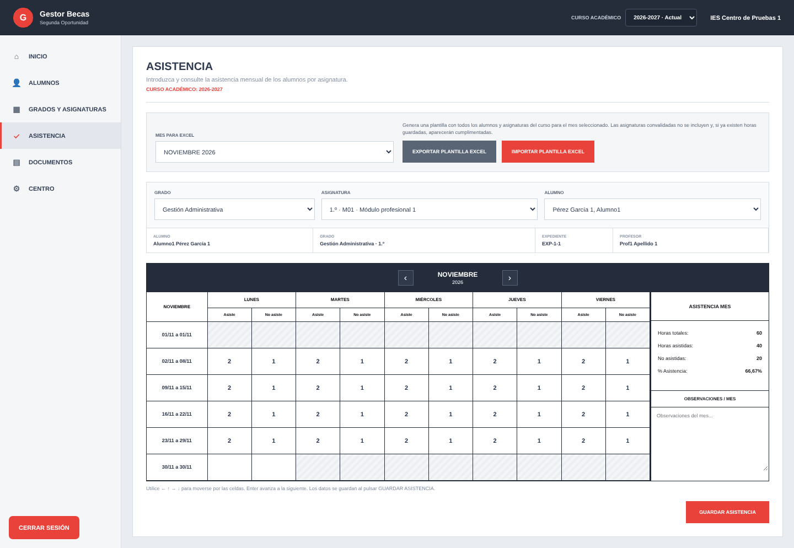
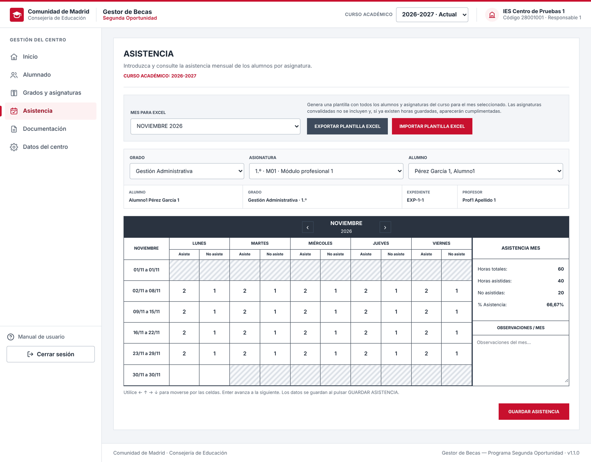
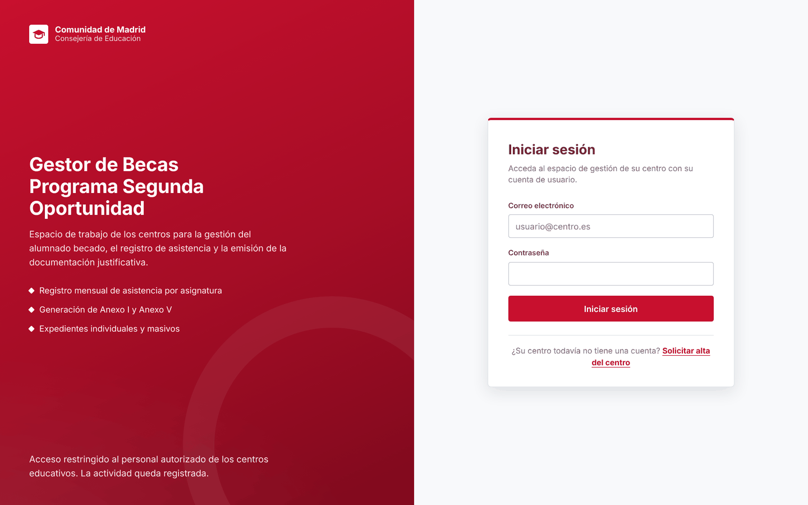
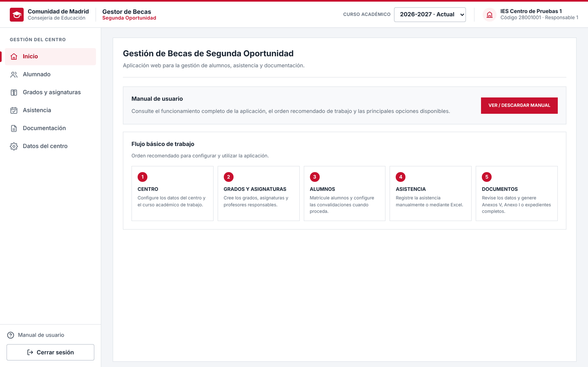
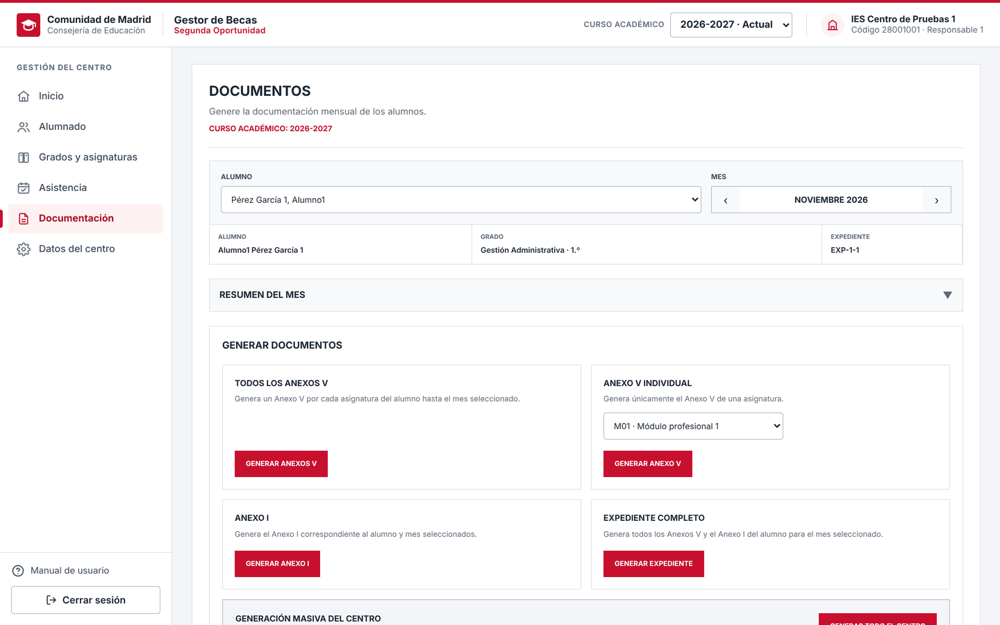
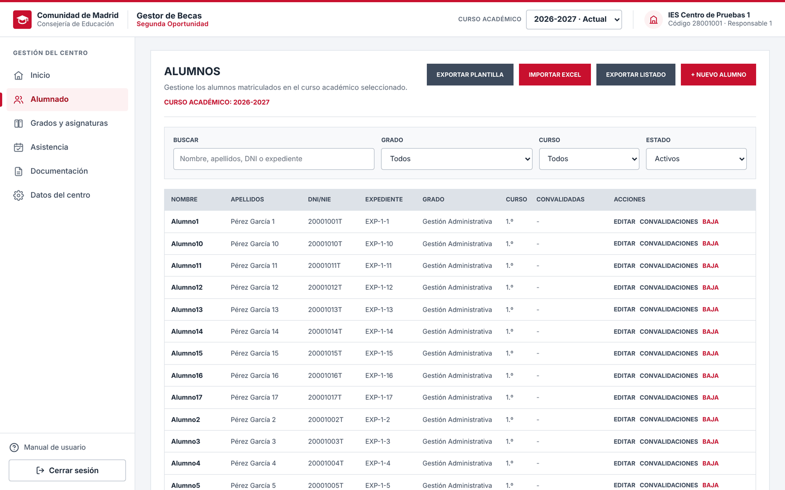

# Gestor de Becas v1.1 — Rediseño institucional, optimización y despliegue para 233 centros

Documento técnico de la versión 1.1.0 (rama `main`, gestor **sin módulo de firma**).

Objetivo: que los **233 centros** (≈ **4.000 alumnos**) trabajen a la vez sin errores ni esperas excesivas, con una interfaz adecuada al entorno corporativo de la Comunidad de Madrid (Consejería de Educación).

---

## 1. Resumen de resultados

Medido en el mismo servidor (4 CPU, MariaDB local), con los mismos datos y peticiones contra la versión 1.0 y la 1.1. Cada centro de prueba tiene 17 alumnos (la media de 4.000 / 233), 6 módulos y 3 meses de asistencia diaria.

| Prueba | v1.0 | v1.1 | Mejora |
|---|---|---|---|
| Expediente masivo de 1 centro (17 alumnos, 102 Anexos V + 17 Anexos I) | 11,1 s | **5,3 s** | **2,1× más rápido** |
| Expedientes masivos de 4 centros a la vez | 43,5 s | **22,9 s** | **1,9× más rápido** |
| 233 guardados de asistencia **simultáneos** | 1,7 s en total, 0 errores | 1,8 s en total, 0 errores | igual (ya era bueno) |
| Navegación de otros usuarios durante las generaciones masivas (p95) | 32 ms | 42 ms | sigue fluida |
| Contenido de los PDF (Anexo I, Anexo V, expediente) | — | **idéntico** | sin cambios en las plantillas |

Los PDF generados por ambas versiones se compararon texto a texto (`pdftotext -layout`) y archivo a archivo dentro del ZIP del expediente: son idénticos.

---

## 2. Optimización del código (qué se ha cambiado y por qué)

### 2.1 Generación de documentos: sin llamadas HTTP internas
**Problema.** «Todos los Anexos V», «Expediente» y «Expediente masivo» llamaban a otras rutas de la propia API con `fetch` HTTP contra el servidor. Un expediente masivo de un centro medio hacía **más de 150 peticiones HTTP** contra sí mismo. Detrás de un proxy inverso con HTTPS, cada una salía al exterior y volvía a entrar (TLS, proxy, autenticación).

**Solución.** `src/lib/llamadaInterna.ts` invoca directamente el manejador de la ruta dentro del mismo proceso. La sesión se sigue validando igual. Los ZIP intermedios, que solo se generan para volver a abrirse, ya no se comprimen (`STORE`); solo se comprime el ZIP que se descarga el usuario.

### 2.2 Generación masiva en paralelo acotado
`expediente-masivo` genera ahora varios alumnos a la vez (`EXPEDIENTES_CONCURRENCIA`, 3 por defecto) y conserva el orden de las carpetas en el ZIP final.

### 2.3 Semáforo de CPU para los PDF
`src/lib/limitador.ts`. La generación de PDF ocupa la CPU y bloquea Node.js. Un semáforo por proceso (`PDF_CONCURRENCIA`, por defecto el número de CPU) limita cuántos documentos se generan a la vez. El resto espera en cola sin consumir CPU, de modo que el login y el guardado de asistencia siguen respondiendo aunque varios centros generen expedientes a la vez.

### 2.4 Consultas N+1 eliminadas
* **Anexo I**: antes hacía una consulta por asignatura y ahora hace **una sola**.
* **Anexo V**: antes hacía una consulta por mes (hasta 10) y ahora hace **una sola**.

En un expediente masivo de 17 alumnos son unas **1.000 consultas menos**.

### 2.5 Plantillas PDF en memoria
`src/lib/plantillas.ts`. Las plantillas `anexo-i-vacio.pdf` y `anexo-v-vacio.pdf` se leen del disco una vez por proceso, no una vez por documento.

### 2.6 Pool de conexiones MySQL
`src/lib/prisma.ts`. El pool pasa de **5 conexiones fijas** a un valor configurable (`DATABASE_POOL_SIZE`, 20 por defecto), con tiempo máximo de espera por conexión, cierre de las conexiones ociosas y un único pool por proceso también en producción.

### 2.7 Índices de base de datos
Nueva migración `20261120000100_indices_rendimiento`:

* `matriculas (centro_id, curso_academico_id, grado_id, curso)`: listados de alumnado y documentación.
* `asistencias (matricula_id, anio, mes)`: resúmenes mensuales por alumno.
* `asistencias (centro_id, anio, mes)`: exportaciones mensuales por centro.

### 2.8 Importaciones robustas
La importación Excel de alumnos usaba el límite por defecto de Prisma para transacciones (5 s). Con cientos de filas y el servidor cargado, podía fallar a mitad. Ahora tiene un margen de 120 s, igual que la importación de asistencia.

### 2.9 Seguridad y depuración
* **Login**: bloqueo temporal tras 8 intentos fallidos en 15 minutos por cuenta (`src/lib/limiteIntentos.ts`). Responde HTTP 429 con `Retry-After`.
* **`/api/estado-db`** se podía consultar **sin sesión** y revelaba el número de centros y de usuarios. Ahora es un *health-check* (`SELECT 1`, latencia y cola de PDF) que puede usar el balanceador o la monitorización.
* **Cabeceras HTTP**: `X-Content-Type-Options`, `X-Frame-Options`, `Referrer-Policy` y `Permissions-Policy`. Además, se oculta `X-Powered-By`.
* **`.gitignore`**: la regla `*.sql` habría descartado las migraciones de Prisma. Se ha añadido una excepción para `prisma/migrations/**/migration.sql`.
* **Migraciones**: el repositorio no tenía ninguna migración SQL, solo `migration_lock.toml`, así que `migrate deploy` no podía crear la base de datos. Se añade la migración base `20261120000000_init`.
* `lang="es"` y metadatos correctos en lugar de «Create Next App»; `noindex`, porque es una herramienta interna.

### 2.10 Pendiente detectado (no modificado)
`npm run lint` informa de **20 avisos que ya existían en la v1.0**: reglas de React sobre `setState` dentro de `useEffect` y funciones usadas antes de declararse. No producen fallos visibles. Corregirlos supone reestructurar la carga de datos de las páginas, así que se recomienda abordarlo en una versión posterior con pruebas funcionales.

---

## 3. Optimización de procesos (organización del trabajo)

La carga real no viene del número de usuarios conectados, sino de **picos concentrados**: todos los centros cerrando el mes el mismo día y generando expedientes a la vez. Se recomienda:

1. **Calendario escalonado de cierre mensual.** Repartir los 233 centros en 3 o 4 turnos por DAT o zona (por ejemplo, Madrid-Capital los días 1 y 2, Norte/Sur los días 3 y 4…). Así el pico de generación masiva baja a la cuarta parte.
2. **Asistencia diaria o semanal, no a fin de mes.** El guardado es muy ligero (233 guardados simultáneos tardan menos de 2 s). Registrarla de forma continua evita el atasco del último día.
3. **Carga inicial por Excel.** Al empezar el curso, usar la plantilla de importación de alumnos y asignaturas en lugar del alta manual. Son minutos frente a horas por centro.
4. **Expediente masivo como último paso.** Comprobar antes el «Resumen del mes» de cada alumno en *Documentación*. Generar el masivo una sola vez cuando todo esté revisado, mejor fuera de las horas punta (antes de las 10:00 o después de las 14:00).
5. **Una cuenta por centro con responsable designado.** Así se evitan sesiones duplicadas que sobrescriban la misma asistencia.
6. **Monitorización.** Consultar `GET /api/estado-db` cada minuto. Si `pdf.enCola` se mantiene alto de forma sostenida, hace falta añadir un proceso o una CPU.

---

## 4. Despliegue recomendado para 233 centros

```text
            Centros (HTTPS)
                  │
        ┌─────────▼─────────┐
        │  nginx (proxy)    │  TLS, gzip, límite de peticiones
        └───┬──────────┬────┘
            │          │
   ┌────────▼───┐  ┌───▼────────┐
   │ Node #1    │  │ Node #2..N │   PM2 cluster (1 proceso por CPU)
   │ next start │  │ next start │
   └────────┬───┘  └───┬────────┘
            └────┬─────┘
          ┌──────▼──────┐
          │ MySQL 8 /   │  max_connections ≥ 200
          │ MariaDB     │  innodb_buffer_pool_size ≥ 1 GB
          └─────────────┘
```

**Dimensionamiento orientativo**

| Recurso | Mínimo | Recomendado |
|---|---|---|
| Servidor de aplicación | 4 vCPU, 8 GB RAM | 8 vCPU, 16 GB RAM |
| Procesos Node (PM2 cluster) | 4 | 1 por vCPU |
| MySQL | 2 vCPU, 4 GB RAM, SSD | 4 vCPU, 8 GB RAM, SSD |
| `DATABASE_POOL_SIZE` | 20 | 20 (× procesos < `max_connections`) |

El volumen de datos es pequeño: 4.000 alumnos × ~6 módulos × 10 meses ≈ 240.000 registros mensuales y unos 5 millones de registros diarios por curso. Con los índices añadidos, MySQL lo gestiona sin problema.

### 4.1 Varios procesos con PM2

```bash
npm ci
npx prisma generate
npx prisma migrate deploy
npm run build
npm install -g pm2
pm2 start node_modules/next/dist/bin/next --name gestor-becas -i max -- start -p 3000
pm2 save
pm2 startup
```

Las sesiones usan JWT firmado en cookie, sin estado en memoria, así que cualquier proceso atiende cualquier petición. El limitador de intentos de login es por proceso. Para un límite global, usar `limit_req` en nginx (abajo).

### 4.2 nginx (fragmento)

```nginx
limit_req_zone $binary_remote_addr zone=login:10m rate=10r/m;

upstream gestor_becas { server 127.0.0.1:3000; keepalive 64; }

server {
  listen 443 ssl http2;
  server_name becas.ejemplo.educa.madrid.org;   # ajustar

  client_max_body_size 20m;          # importaciones Excel
  proxy_read_timeout 300s;           # expedientes masivos de centros grandes

  location = /api/login {
    limit_req zone=login burst=5 nodelay;
    proxy_pass http://gestor_becas;
  }

  location / {
    proxy_pass http://gestor_becas;
    proxy_http_version 1.1;
    proxy_set_header Connection "";
    proxy_set_header Host $host;
    proxy_set_header X-Forwarded-For $proxy_add_x_forwarded_for;
    proxy_set_header X-Forwarded-Proto https;
  }
}
```

Si nginx ya comprime con gzip, se puede poner `DISABLE_COMPRESSION=1` para que Node no lo haga dos veces.

### 4.3 MySQL (`my.cnf`, orientativo)

```ini
[mysqld]
max_connections          = 300
innodb_buffer_pool_size  = 2G
innodb_flush_log_at_trx_commit = 1
character-set-server     = utf8mb4
collation-server         = utf8mb4_unicode_ci
```

### 4.4 Migraciones en una instalación existente (v1.0 → v1.1)

Las bases de datos creadas con la v1.0 ya tienen las tablas, pero no tienen historial de migraciones. **Hacer antes una copia de seguridad** y después marcar la migración base como aplicada:

```bash
npx prisma migrate resolve --applied 20261120000000_init
```

```bash
npx prisma migrate deploy
```

El segundo comando solo crea los 3 índices nuevos, sin tocar los datos. En una **instalación nueva** basta con `npx prisma migrate deploy`.

---

## 5. Rediseño visual institucional

### 5.1 Criterios
* **Identidad**: rojo institucional (`#C8102E`) sobre fondos blancos y grises neutros, franja roja superior, identificación del organismo y del departamento en la cabecera, y pie institucional.
* **Accesibilidad (RD 1112/2018, WCAG 2.1 AA)**: contraste mínimo de 4,5:1 en todos los textos (rojo sobre blanco 5,9:1; texto secundario 5,4:1). Los tamaños de 7 a 9 px, ilegibles, pasan a un mínimo de 11 px. Hay foco visible al navegar con teclado, enlace «Saltar al contenido», `aria-current` en el menú y `role="alert"` en los errores.
* **Rendimiento**: fuentes del sistema (Segoe UI, Roboto…), sin descargar fuentes web. Iconos SVG en línea en lugar de emojis, que se veían distintos en cada equipo.

### 5.2 Sistema de diseño
Todos los colores salen de *tokens* CSS en `src/app/globals.css` (`--cm-rojo`, `--cm-texto`, `--cm-borde`…). Los estilos de las páginas usan `var(--cm-…)`, así que **un cambio de marca se hace en un único archivo**. Los ~80 colores sueltos que había repartidos por el código se han unificado en 20 tokens.

### 5.3 Marco de la aplicación
* **Cabecera blanca** con franja roja: organismo y departamento, nombre de la aplicación y programa, selector de curso académico, y centro con su código y el usuario conectado.
* **Menú lateral** con iconos, «Gestión del centro», acceso al manual y cierre de sesión. Al imprimir se ocultan la cabecera y el menú.
* **Pantalla de acceso** en dos columnas: panel institucional y formulario.
* Se han corregido columnas recortadas en *Alumnado* (acciones) y en *Asistencia* (resumen del mes).

### 5.4 Logotipo oficial
El aplicativo **no incluye** el logotipo de la Comunidad de Madrid: su uso está regulado por el Manual de Identidad Corporativa. Mientras no se configure, se muestra un símbolo neutro. Para usar el logotipo, si el órgano está autorizado:

1. Copiar el archivo a `public/marca/logo-institucional.svg`.
2. Poner `NEXT_PUBLIC_LOGO_INSTITUCIONAL=1` en `.env`.
3. Revisar en `src/lib/marca.ts` la denominación vigente de la Consejería.
4. Recompilar con `npm run build`.

### 5.5 Capturas

| Antes | Después |
|---|---|
|  |  |





